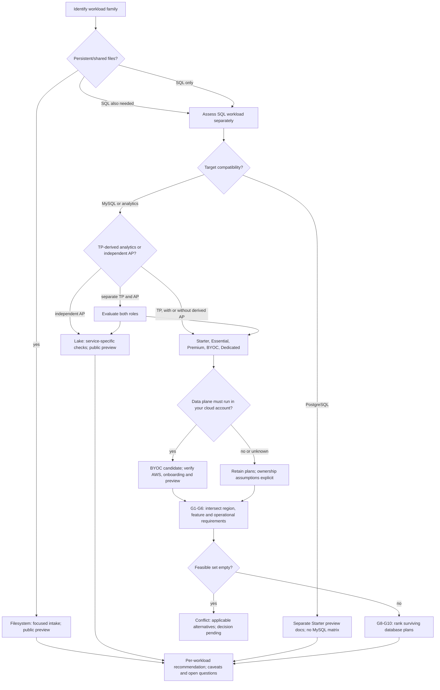

# Product selection and requirement filtering

Verified matrix: 2026-10-30. Read `product-matrix.md` for evidence and lifecycle caveats.
Route by product family before applying gates. Each constraint **intersects** the current
set; a later lock cannot resurrect a rejected option. Unknown support is an open question
and a conditional recommendation, not a verified match or an automatic exclusion.

## Routing map

For mixed file/database/warehouse needs, recommend each service for its own role.
Do not imply that Filesystem stores Lake tables, imports S3 directly, or replicates SQL.
An explicit Filesystem-only request skips database migration defaults and sizing.

## Phase 0 — Is the analytical workload tied to TP transactions?

Selection guidance: [TiFlash vs Lake: Selection Guide](https://docs.google.com/document/d/1ZDQs9fBaLbnURM2aTshQoowIZPVU72j2Q2scXlzEw-U/edit?tab=t.0),
last modified 2026-10-23; incorporated 2026-10-30. This is workload-selection guidance; use the separately refreshed 2026-10-30
product matrix for availability.

The primary rule is **AP requirements derived from a core TP workload → TiFlash; pure AP
(data-warehouse-style) → Lake.** TiFlash is a columnar replica engine within a transactional
TiDB offering, not a separate offering. Ask about the business system and the relationship
between its transactions and reports before classifying slow queries or large joins.

| Workload relationship | Effect |
|---|---|
| Pure OLTP, no analytical requirement | **Exclude Lake**; select among the five MySQL-compatible database plans. No TiFlash requirement. |
| Core TP system with derived analytics (billing, orders, transactions; a few reports or real-time queries needing fresh, consistent data in the same database) | **TiFlash direction; exclude Lake for this workload.** Select a transactional offering with confirmed TiFlash support (Dedicated is the established full-HTAP candidate; confirm exact engine availability). Do not assume every transactional tier has TiFlash. |
| Pure AP with no TP transaction binding, including a standalone warehouse | **Lake direction**, even below 50 TB. Do not retain TiDB + TiFlash merely because it can execute analytical SQL. Validate Lake requirements separately from G1–G6. |
| TP and independent AP as separate systems | Evaluate each workload separately. A transactional tier (with TiFlash if it has TP-derived reports) and Lake may both be appropriate; state their respective roles and the unverified integration path. |

When G0 identifies TP-derived analytics that requires TiFlash, intersect the transactional
candidates with confirmed TiFlash-capable offerings before continuing. The comparison
only says analytical processing, not which engine. Dedicated is the established full-HTAP
candidate; for BYOC or another plan, confirm TiFlash support explicitly; do not let G8/G9 select an elastic tier without
confirming TiFlash support. If confirmation is pending, make the recommendation conditional.

### Volume and processing signals

The guide describes the typical TiFlash profile as a core TP system, a small number of
derived reports, fresh/consistent AP and TP data, and volume within 50 TB. Pure AP with
**more than 50 TB**, large scans, large-table join aggregations, or warehouse-style
multi-layer modeling is a strong direct-to-Lake case. These are selection signals,
**not a TiFlash capacity limit or a rule to move a core TP system to Lake at 50 TB**.
Exactly 50 TB remains in the guide's "within 50 TB" profile; workload binding still decides.

The guide's cost rationale: TiFlash is paired with a three-replica TiKV row store. At
100 TB of pure AP, retaining the row data alongside columnar replicas adds row-store
storage without a TP purpose. Explain that architectural overhead qualitatively; do not
calculate physical bytes, node counts, compression, or a price from this example.

For TP-bound analytics above 50 TB, retain the TP requirement, flag the atypical scale,
and request TiFlash architecture/sizing review. If an independent AP subsystem can be
separated, assess Lake for that subsystem without moving the transaction system to Lake.

Use intake items 2 and 7. If workload binding is unknown, default to transactional, leave
the binding unconfirmed, and record the assumption —
most PoC conversations are migrations, and wrongly proposing a warehouse is a worse failure
than wrongly omitting one.

**This exclusion is reversible during conflict arbitration.** If Phase 1–2 produces an empty
feasible set, Lake returns as Route B — at that point it is being offered as a deliberate
architecture change, not as a match to the stated workload.

## Deployment ownership — before G1

An explicit requirement for the **data plane in your own cloud account** points to BYOC.
The current introduction documents AWS public preview; confirm the region, onboarding,
permissions, and all remaining requirements. This does not override G1–G6. If BYOC is
required but another requirement excludes it, report the collision, not Dedicated as an
ownership-equivalent replacement. A customer-owned bucket alone is not a BYOC requirement.
If ownership is unspecified, do not assume it is required or prescribe cloud onboarding.

## G1 — Provider and region (MySQL-compatible plans only)

| Requirement | Eligible plans before other gates |
|---|---|
| AWS | All five; confirm exact region |
| Google Cloud | Dedicated |
| Azure | Dedicated; Premium/BYOC are under development, not available |
| Alibaba Cloud | Starter, Essential, Premium; BYOC under development, Dedicated unavailable |

Check Lake, Filesystem, and PostgreSQL-compatible Starter regions separately.

## G2 — Infrastructure, isolation, and security

| Requirement | Effect |
|---|---|
| Node groups or resource control | Dedicated; Premium/BYOC resource control is under development |
| Dual-region backup | Dedicated; Premium/BYOC under development |
| VPC peering | Dedicated normally; Premium/BYOC only with explicit private-preview acceptance and confirmed access |
| CMEK | Dedicated normally; Premium only with confirmed private-preview access; BYOC under development |
| Manual modification or pause/resume | BYOC or Dedicated; ownership and other gates decide |
| Private endpoint alone | No exclusion; all five show support |
| Audit logging | Premium, BYOC, Dedicated (Dedicated feature is public preview); Essential only with confirmed private-preview access |

Ask multi-tenant teams about noisy-neighbor problems before assuming they need node groups.
Cross-AZ failover alone does not imply Dedicated: Premium/BYOC also support it. A private
preview is a conditional alternative until access is confirmed, not a silent hard match.

## G3 — Search and target compatibility

The MySQL matrix lists vector and full-text search on Starter in public preview. Premium
and BYOC full-text are under development; do not offer them as available. When this conflicts
with production constraints, first confirm actual tier/version support against live docs or
your TiDB contact. The previous vector-overview discrepancy was not reverified this refresh.

Lake's overview separately documents vector, text-search, and geo capabilities. It can
serve independent AP or a separable analytical/search role, not replace required TP.
Do not route TP-derived reports to Lake solely because queries scan or join large tables.
Confirm TiFlash availability if required; the generic analytical-processing row does not
prove engine support on Starter, Essential, Premium, or BYOC.

PostgreSQL-compatible Starter is a separate preview track. Do not run this gate's MySQL
search rules or the MySQL compatibility list against it without checking its own docs.

## G4 — Incoming MySQL migration (DM)

Exclude Starter for a verified DM requirement. Essential, Premium, and BYOC have DM in
public preview; Dedicated is listed supported. A strict GA requirement excludes those
preview paths and still requires confirmation of the exact Dedicated workflow. Do not
confuse incoming DM with outgoing changefeeds. The database migration playbook does not
establish ingestion support for Lake or Filesystem.

## G5 — Outgoing changefeeds

For changefeeds to Kafka or another MySQL-compatible database, keep Premium, BYOC, and
Dedicated. Essential requires confirmed private-preview access; Starter is unavailable.
A generic ongoing-sync requirement must be mapped to an actual supported tool before
applying this gate. File sharing and Filesystem layers are not database CDC.

## G6 — Operations, recovery, and deployment mode

- PITR, alerting, or Top SQL/Top RU excludes Starter. Essential/Premium/BYOC use Top RU
  public preview; do not describe it as identical to Dedicated Top SQL.
- Manual backups keep Premium, BYOC, Dedicated.
- Prometheus/Grafana: Essential/Premium public preview, BYOC private preview, Dedicated
  supported. Starter unavailable.
- Datadog **and New Relic**: Essential/Premium public preview or Dedicated; BYOC/Starter
  unavailable. New Relic alone no longer locks Dedicated.
- File export: Starter/Essential/Premium/BYOC public preview; Dedicated unavailable.
  This is bulk export, not a changefeed or Filesystem integration.
- Single-AZ is listed for Essential/BYOC; cross-AZ failover for Premium/BYOC/Dedicated.
  Validate whether single-AZ is required or merely acceptable; do not exclude cross-AZ
  plans just because the workload can tolerate single-AZ.
- Events are listed on every plan; do not exclude Premium using the old snapshot.

## G7–G10 — Rank survivors

- **G7 Lake**: independent pure AP; keep TP binding primary and the earlier 50 TB signal
  secondary. Use the service-specific reference and public-preview caveat.
- **G8 Starter**: developer workloads needing its features and allowance, where the surviving
  operational constraints fit. Target compatibility and cloud affect preview status.
- **G9 Essential/Premium**: elastic database workloads; Essential for simpler production
  needs, Premium when cross-AZ, outgoing changefeeds, or stronger audit requirements apply.
  Both are public preview; do not promise GA production guarantees.
- **G10 Dedicated/BYOC**: Dedicated for supported compliance/isolation/region constraints
  and confirmed full HTAP; BYOC for own-cloud data-plane requirements with compatible
  features and preview tolerance. BYOC autoscaling does not imply pay-as-you-use billing.

## Conflicts and output

For an empty set, name the exact requirements, evidence dates, and their incompatible
support. Leave the final decision pending. For a search-versus-production conflict, compare:

| Route | Costs and complexity to explain | Boundary |
|---|---|---|
| Split search and transactional clusters | Multiple services, query routing, synchronization and freshness | Each side must satisfy its own requirements |
| Lake for a separable AP/search role | Warehouse compute, data movement, integration validation | Public preview; retain TP separately |
| External search service | Third-party cost, synchronization and consistency management | Confirm integration and service status; do not promise no preview dependencies |

For other collisions, present relevant alternatives rather than forcing this search list.
Examples include BYOC plus GCP, BYOC plus mandatory New Relic, or GA-only plus Filesystem.

Produce: recommendation per workload, requirement-to-gate rationale, reasons for each
exclusion, public/private-preview dependencies, unverified items, and applicable conflicts.
Filesystem/Lake unknowns must remain conditional rather than being filtered by SQL tier gates.

## Worked cases for review

| Input | Expected direction |
|---|---|
| Core billing, 20 TB, two fresh reports | TiFlash-capable database plan; confirm engine |
| Standalone 10 TB warehouse | Lake; no 50 TB minimum |
| Independent AP, 100 TB, multi-layer joins | Lake; avoid unnecessary TiKV row-store overhead |
| TP-derived analytics at exactly 50 TB | TiFlash direction; threshold is not a product limit |
| TP-derived analytics at 80 TB | Retain TP and request architecture/sizing review |
| TP plus separate AP plus shared agent artifacts | Separate database, Lake, and Filesystem roles; verify integrations |
| Slow reports, TP binding unknown | Analytical direction unconfirmed; record assumptions |
| Pure AP on GCP with CMEK | Lake-specific verification, not automatic Dedicated |
| AWS data plane required in your account | BYOC conditional on region, features, onboarding, preview tolerance |
| Same ownership requirement on GCP | Conflict; current BYOC matrix has no GCP support |
| Manual resizing, AWS, ownership unspecified | BYOC/Dedicated remain until other constraints and preferences decide |
| New Relic, AWS, elastic billing, preview accepted | Essential/Premium candidates; not a Dedicated hard lock |
| BYOC required plus mandatory New Relic | Conflict; BYOC integration marked unavailable |
| Premium bulk file export or Events | Supported snapshot path (export preview); do not use old exclusions |
| BYOC plus Prometheus, private preview not approved | Conditional access or conflict; no silent support claim |
| Persistent files across CI jobs, no SQL | Filesystem only; no database provisioning, binlogs, or sizing |
| Filesystem with GA-only policy | Preview conflict; no GA promise |
| PostgreSQL-compatible target requested | Separate Starter preview docs, not the MySQL table |
