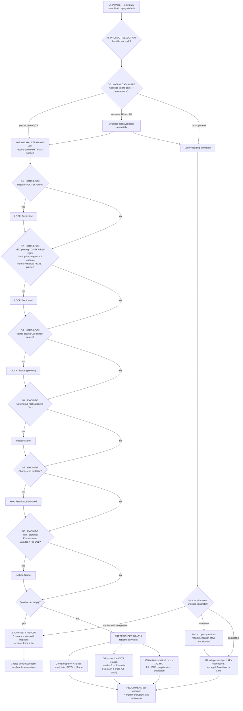

# Product Selection Decision Tree

Evaluate the gates **in order**. Carry a *feasible set* of offerings, starting with
`{Starter, Essential, Premium, Dedicated, Lake}`. Hard locks intersect the eligible candidates; exclusions
remove members; preferences rank whatever survives. Never reintroduce an excluded offering
to satisfy a later gate. G1–G6 describe the four transactional tiers in the snapshot matrix,
not verified Lake capabilities. For a pure-AP Lake candidate, confirm deployment, ingestion,
search, security, and recovery requirements against Lake documentation or the TiDB contact;
record unverified requirements as open questions and confirmed incompatibilities as conflicts.

Record, for every gate that fires, which input triggered it — the report must explain why
each offering was excluded, not just which one won.

## Mind map

---

## Phase 0 — Is the analytical workload tied to TP transactions?

Selection guidance: [TiFlash vs Lake: Selection Guide](https://docs.google.com/document/d/1ZDQs9fBaLbnURM2aTshQoowIZPVU72j2Q2scXlzEw-U/edit?tab=t.0),
last modified 2026-10-23; incorporated 2026-10-30. This supplements the older feature-matrix
snapshot; it does not refresh feature or preview availability.

The primary rule is **AP requirements derived from a core TP workload → TiFlash; pure AP
(data-warehouse-style) → Lake.** TiFlash is a columnar replica engine within a transactional
TiDB offering, not a separate offering. Ask about the business system and the relationship
between its transactions and reports before classifying slow queries or large joins.

| Workload relationship | Effect |
|---|---|
| Pure OLTP, no analytical requirement | **Exclude Lake**; select among the four transactional tiers. No TiFlash requirement. |
| Core TP system with derived analytics (billing, orders, transactions; a few reports or real-time queries needing fresh, consistent data in the same database) | **TiFlash direction; exclude Lake for this workload.** Select a transactional offering with confirmed TiFlash support (the snapshot identifies Dedicated for full HTAP). Do not assume every transactional tier has TiFlash. |
| Pure AP with no TP transaction binding, including a standalone warehouse | **Lake direction**, even below 50 TB. Do not retain TiDB + TiFlash merely because it can execute analytical SQL. Validate Lake requirements separately from G1–G6. |
| TP and independent AP as separate systems | Evaluate each workload separately. A transactional tier (with TiFlash if it has TP-derived reports) and Lake may both be appropriate; state their respective roles and the unverified integration path. |

When G0 identifies TP-derived analytics that requires TiFlash, intersect the transactional
candidates with confirmed TiFlash-capable offerings before continuing. With the current
snapshot, use Dedicated for full HTAP; do not let G8/G9 select an elastic tier without
confirming TiFlash support. If confirmation is pending, make the recommendation conditional.

### Volume and processing signals

The guide describes the typical TiFlash profile as a core TP system, a small number of
derived reports, fresh/consistent AP and TP data, and volume within 50 TB. Pure AP with
**more than 50 TB**, large scans, large-table join aggregations, or warehouse-style
multi-layer modeling is a strong direct-to-Lake case. These are selection signals,
**not a TiFlash capacity limit or a rule to move a core TP system to Lake at 50 TB**.
Exactly 50 TB remains in the guide's "within 50 TB" profile; workload binding still decides.

The guide's cost rationale: TiFlash is paired with a three-replica TiKV row store. At
100 TB of pure AP, retaining the row data alongside columnar replicas adds row-store
storage without a TP purpose. Explain that architectural overhead qualitatively; do not
calculate physical bytes, node counts, compression, or a price from this example.

For TP-bound analytics above 50 TB, retain the TP requirement, flag the atypical scale,
and request TiFlash architecture/sizing review. If an independent AP subsystem can be
separated, assess Lake for that subsystem without moving the transaction system to Lake.

Use intake items 2 and 7. If workload binding is unknown, default to transactional, leave
the binding unconfirmed, and record the assumption —
most PoC conversations are migrations, and wrongly proposing a warehouse is a worse failure
than wrongly omitting one.

**This exclusion is reversible during conflict arbitration.** If Phase 1–2 produces an empty
feasible set, Lake returns as Route B — at that point it is being offered as a deliberate
architecture change, not as a match to the stated workload.

## Phase 1 — Hard locks

A hard lock intersects the current feasible set with the permitted offering(s); it cannot
reset that set. If the result is empty or two hard locks disagree, that is a conflict —
jump to *Conflict arbitration*. Apply these tier gates to transactional candidates only,
including the transactional side of a split design.

### G1 — Cloud provider and region

| Requirement | Result |
|---|---|
| Google Cloud region | **LOCK Dedicated** (Starter/Essential/Premium have no GCP) |
| Azure region | **LOCK Dedicated** (Premium on Azure is under development) |
| AWS region | no constraint |
| Alibaba Cloud region | excludes Dedicated |

Ask for the region explicitly. Customers often state a cloud without realizing it is the
single most binding constraint in the whole conversation.

### G2 — Enterprise infrastructure and compliance

Any one of these **LOCKs Dedicated**:

- VPC peering (private endpoint alone does **not** trigger this — all tiers have it)
- CMEK (customer-managed encryption keys)
- Dual-region backup
- **Workload / tenant isolation inside one cluster** — node groups, resource control, quotas.
  See the note below; this one you usually have to ask about rather than being told.
- Manual cluster resizing, or pause & resume
- New Relic integration

**Ask about tenant isolation explicitly for any multi-tenant or SaaS customer.** Customers
describe their noisy-neighbour problem as an operational complaint ("one customer's report
slows everyone down", "we had to move that tenant to its own instance") and almost never as a
product requirement — so it rarely surfaces on its own, and then appears late as a surprise
constraint. TiDB Cloud Dedicated addresses it with **resource control** (quotas per user or
workload) and **node groups** (physically separate compute within one cluster). Neither exists
on Starter or Essential, and resource control is still under development on Premium, so this is
a genuine hard lock rather than a preference. It is also far cheaper to design in at PoC time
than to retrofit once tenants are live.

Database audit logging is *not* here — it is available on Premium (✅) and Dedicated (✅), so
it narrows rather than locks.

### G3 — Vector search or full-text search

Per `product-matrix.md`, these live on **Starter only**.

| Requirement | Result |
|---|---|
| Vector search, or full-text search | **LOCK Starter** (preview) |
| Independent pure AP identified in G0 | Already on the separate Lake path (public preview); verify its search capabilities there, not through the transactional tier lock |

Distinguish carefully: a transactional app that also does semantic retrieval → Starter.
An independent AP platform with vector or full-text as one of several engines → Lake.
Large scans or joins within core TP-derived reporting do not by themselves make it pure AP.
If G0 requires TiFlash and G3 points to Starter, confirm the actual TiFlash/search tier
support or report a conflict; do not silently replace the TP requirement with Lake.

Always attach the preview caveat, and the documentation-contradiction note from
`product-matrix.md`, whenever this gate fires.

---

## Phase 2 — Exclusions

### G4 — Continuous replication from production (DM)

If they need ongoing replication from a live source database (not a one-shot
cutover): **exclude Starter.** DM is unavailable there.

Essential and Premium have it in preview; Dedicated has it GA. If they need DM to be
GA rather than preview, narrow further to Dedicated.

### G5 — Changefeed to Kafka

Downstream streaming (Kafka, and by extension Flink/data-lake pipelines fed from it):
**keep only Premium and Dedicated.** Essential has it in private preview (🔒, needs a support
ticket); Starter has none.

### G6 — Production observability and recoverability

Any one of these **excludes Starter**:

- Point-in-time recovery
- Alerting
- Prometheus / Grafana integration
- Datadog integration
- Top SQL
- Manual backup (narrows to Premium/Dedicated)

Most customers describing a production migration will trip at least one of these. That is
usually what rules Starter out even when nobody said "we need PITR" — ask.

---

## Phase 3 — Preferences

Apply to whatever survived. These rank rather than eliminate; if several fire, prefer the one
matching their *primary* workload.

### G7 → Lake
Independent pure AP / data warehouse with no TP transaction binding. Large scans,
large-table join aggregations, multi-layer data modeling, and volume >50 TB reinforce
this direction; Iceberg or replacing Snowflake/BigQuery/Redshift are supporting context.
Do not override G0 merely because a TP-bound report is slow or scans a large table.
Always label public preview.

### G8 → Starter
Developer projects and **AI/SaaS applications**; small or unknown data volume; wants
pay-as-you-go with no capacity planning; values SQL Editor and Data Branch; no production
recovery/observability requirements yet.

### G9 → Essential
Production OLTP that wants elasticity and no capacity management. Adds PITR, alerting,
backup recycle bin, DM (preview) over Starter.
**Prefer Premium instead** if they need cross-AZ failover, Kafka changefeeds,
manual backup, or database audit logging — and label Premium public preview.

### G10 → Dedicated
Mission-critical systems; cross-AZ HA; **full HTAP via TiFlash**; enterprise compliance;
predictable provisioned capacity; GCP/Azure. This is also where everything locked by G1/G2
lands.

---

## Conflict arbitration

**Trigger**: the feasible set is empty, or two hard locks disagree.

The structural cause is almost always G3 (vector/full-text → Starter) colliding with
G1/G2/G4/G5/G6 (→ away from Starter). Concretely: *anything that needs vector or full-text
search plus anything production-grade.*

**Do not resolve this yourself. Do not pick a tier anyway.** Emit a "⚠️ Requirement conflict"
section naming the exact requirements that collide. For the search-versus-production
conflict, present all three routes below with their tradeoffs. For other conflicts (including
a confirmed Lake incompatibility), present alternatives that address the actual collision;
do not force search-specific routes. Let them choose:

### Route A — Split clusters
Starter for the vector / full-text workload, Essential or Dedicated for transactional data.
The application routes queries to the right cluster.

- **Cost**: two clusters.
- **Complexity**: application-layer routing; data must be synchronized between them, and the
  sync path itself needs designing (this is an open question, not a solved one).
- **Risk**: the search side is still on a preview feature.
- **Best when**: the search workload is genuinely separable from the transactional one.

### Route B — TiDB Cloud Lake
One engine covering ANSI SQL, vector, and full-text.

- **Cost**: warehouse compute, separate from the transactional cluster.
- **Complexity**: low if analytics is the whole story; the Lake ↔ transactional-cluster
  integration path is not clearly documented — flag it.
- **Risk**: public preview. Not appropriate for a customer who needs GA guarantees.
- **Best when**: the workload is analytics-first and they tolerate preview.

### Route C — Externalize search
Keep business data in TiDB (any tier that satisfies the production constraints); put vector
or full-text in a purpose-built external service.

- **Cost**: a third-party service.
- **Complexity**: dual writes and consistency management between TiDB and the search store.
- **Risk**: lowest on the TiDB side — no preview dependency.
- **Best when**: production constraints are non-negotiable and search is secondary.

Also state the fourth possibility explicitly: **confirm the vector tier availability first.**
Because the TiDB docs contradict each other (see `product-matrix.md`), the conflict may not
be real. Asking their TiDB contact before redesigning the architecture is the cheapest
move available and should be listed as the first action item.

---

## Worked selection cases

| Input | Expected direction | Reason / follow-up |
|---|---|---|
| Core billing system, 20 TB, two fresh reports on the same data | TiFlash on a confirmed supporting tier | Analytics is derived from core TP. |
| Standalone 10 TB warehouse, no TP in scope | Lake | Pure AP is sufficient; >50 TB is not a minimum. |
| Pure AP, 100 TB, multi-layer models and large joins | Lake | No TP purpose for the extra TiKV row store. |
| Core order system, exactly 50 TB, fresh reports | TiFlash direction | Within the typical profile; not a capacity boundary. |
| Core billing system, 80 TB, same-database consistency required | TiFlash direction plus architecture/sizing review | Volume does not erase TP binding. |
| Core TP plus a separate 100 TB warehouse | Transactional tier for TP; Lake for AP | Record both roles and confirm integration. |
| Slow reports only; TP binding and volume unknown | Analytical engine to be confirmed | Record provisional OLTP assumption; prioritize the TP-binding question. |
| Pure AP on GCP with CMEK required | Lake direction, deployment/security unconfirmed | G1/G2 transactional locks cannot establish Lake support or select Dedicated for pure AP. |
| TP-derived analytics requiring TiFlash plus full-text search | Confirm tier support or report conflict | G3 cannot reintroduce Starter if it lacks required TiFlash support. |

---

## Output format for Stage B

Produce, in this order:

1. **Recommendation** — one offering per workload, named; for separate TP and AP systems,
   name both roles. State TiFlash / Lake / no analytical engine / to be confirmed and the
   TP-binding evidence. A conflict leaves the final choice pending rather than naming a
   winner. Record volume signals without treating 50 TB as a product limit.
2. **Why** — the gates that led there, quoting their own stated requirement for each.
3. **Why not the others** — one line per excluded offering, naming the gate that removed it.
   Never leave an offering unexplained; "not recommended" without a reason is not acceptable
   output.
4. **Preview/beta caveats** — every preview-status feature the recommendation depends on.
5. **Conflicts**, if any — the full arbitration section above.
